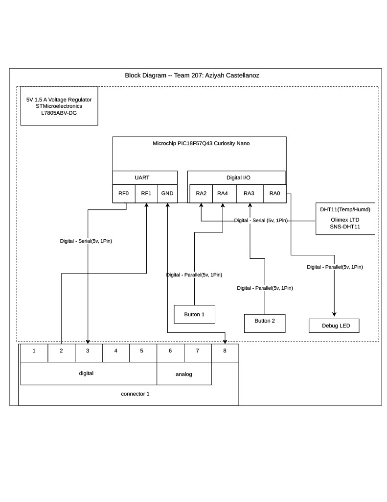

** Team 207 | Aziyah Castellanoz** 
**Subsystem:** Temperature & Humidity Sensing Transmission

## Overview
This needs to be updated with a brief purpose for having the block diagram.
Things to mention are:

The purpose of this block diagram is to define the electrical design, signal flow, power distribution, and the board interface connections for the Temperature & Humidity Sensing Transmission Subsystem. 

This diagram documents how major integrated circuits, digital signal connection, and user interface peripherals connect to the PIC18F57Q43 Curiosity Nano microcontroller, as well as how data and digital signals pass to the main board thorough the team's 8-pin connector. 

---

### Key Architectural Elements 

 **Power Sources and Voltage**
 * **External Power Input:** 12V DC wall adapter entering through a PCB barrel jack which is protected by a inline fuse.
 * **Regulated Logic Rail(5V DC):** L7805ABV-DG 1.5A linear regulator with input(0.33uf) and output(0.1uf) filtering capacitors.
 * **Ground** Common system Earth Ground rail shared across all block and team interfaces.

 **Sensor Subsystem:**
 * **DHT11 Temperature and Humidity Sensor** Single-bus digital environmental sensor operating on 5V with a 10k pull up resistor
 * **Op-Amp Buffer Stage:** Using the MCP6004 the DHT11 will pass through the op-amp to prevent signal degradation and input loading.

 **User Interface and Debugging Indicators:**
 * **Pushbuttons:** Active user input switches tied to RA4 and RA3 with 10k pull up resistors.
 * **Debug Status LED:** General purpose visual status indicator on pin RA0 with a 300 ohm current limiting resistor.
 * **Spare GPIO Expansion Header:** 1x6 male header that has power, ground, and 4 unused GPIO pins for testing or probing.

 **Team Inter-Board Connections(8-pin Header):**
* **Pin 1 ('DigitalSignal2'):** Digital control line routed to PIC pin RA3.
* **Pin 2 ('DigitalSignal1'):** Digital control line routed to PIC pin RA4.
* **Pin 3 ('UART_TX'):** UART serial data output from PIC transmitting sensor data packets to main board.
* **Pin 4 ('UART_RX'):** UART serial data input to PIC receiving commands from the main board. 
* **Pin 5-7 ('DigitalSignal2'):** Reserved pass-through lines for team expansion
* **Pin 8 ('Earth' Ground):** Class stnadard common ground return line
---

## Subsystem Block Diagram 

