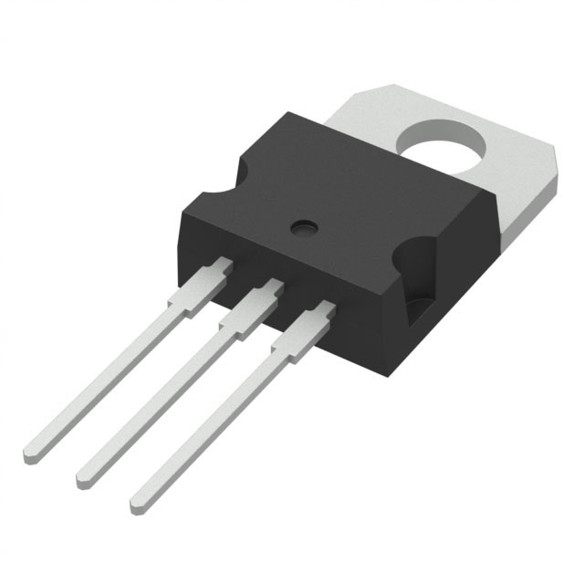
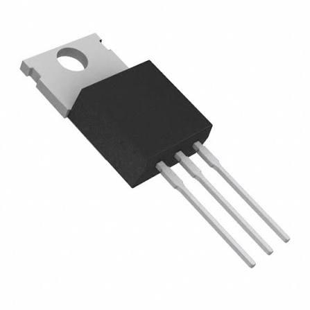
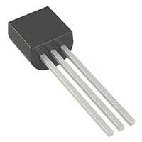
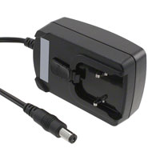
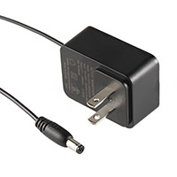
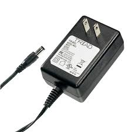

**Tempature & Humidity Sensing Transmission**

| **Component 1: Temperature & Humidity Sensor **                                                                                                                                                                                      | **Pros**                                                                                                                                    | **Cons**                                                                                            |
| ------------------------------------------------------------------------------------------------------------------------------------------------------------------------------------------------- | ------------------------------------------------------------------------------------------------------------------------------------------- | --------------------------------------------------------------------------------------------------- |
|  Option 1.  1188-SNS-DHT11-ND $3.95/each [link to product](https://www.digikey.com/short/f338bv47)                 | \* high humidity range \* Only needs one GPIO pin  \* Compact for small project deisgn                                               | \* Lower accuracy \* Maximum sampling rate 1HZ |
|  \* Option 2.  \* CANADUINO 26085  \* $2.39/each  \* [Link to product](https://www.digikey.com/short/wm7pmcbw) | \* Cheaper than other options  \* Wide voltage range   \* 16 bit output provides high resolution data | * Low relative humidity(RH) limit  \* lower quality DHT11                                                         |
|  \* Option 3.  \*  1188-SNS-DHT22-ND  \* $7.30/each  \* [Link to product](https://www.digikey.com/short/mtzfnvnt) | \*High precision  \* Fast response time   \* Industry Stadard | * Expensive  \* Harder to hand solder   \* Require external pull-up resistors                                                        |

**Choice:** Option 1: 1188-SNS-DHT11-ND Sensor 

**Rationale:** Since our design does not require precise readings and operates natively on a 5V rail, the DHT11 is the best choice. Not only is the component within budget constraints, it also only uses one GPIO pin leaving the remaining pins open for UART communication. 

| **Component 2: 5v Linear Voltage Regulator **                                                                                                                                                                                      | **Pros**                                                                                                                                    | **Cons**                                                                                            |
| ------------------------------------------------------------------------------------------------------------------------------------------------------------------------------------------------- | ------------------------------------------------------------------------------------------------------------------------------------------- | --------------------------------------------------------------------------------------------------- |
|  Option 1.  L7805ABV-DG $1.53/each [link to product](https://www.digikey.com/short/15pzw22v)                 | \* High output accuracy \* Wide operating temperature  \* Stable over a wide input voltage range                                               | \* Gets hot too quickly  \* Requires a minimum of 2v dropout voltage |
|  \* Option 2.  \* MC7805CTGOS-ND $1.01/each  \* [Link to product](https://www.digikey.com/short/tq2pv7h9) | \* Low dropout voltage  \* Built in heatsink   \* High current capability | * Poor power efficiency  \* Maximum output current limited to 250 mA   \* Consumes a operating current of 5mA to 6.5mA                                                     |
|  \* Option 3.  \*  MCP1700-5002E/TO-ND  \* $0.50/each  \* [Link to product](https://www.digikey.com/short/9zw8dnb0) | \*Extremely inexpensive   \* Very low operating current(µA)   \* Built in circuit protection | * Narrow input voltage margin  \* Requires input/output filter capacitros for sabaility                                            |

**Choice:** Option 1: L7805ABV-DG

**Rationale:** The L7805ABV-DG was selected due to its capability of sourcing a 1.5A max output current which will provide a safe current for our design and its built in circuit protection incase of a short circuit. It is also a standard stock component, even being used in some of the in class Lab, also providing thermal protection feature such as a heatsink to reduce heat with high voltage.

| **Component 3: External Power Supply **                                                                                                                                                                                      | **Pros**                                                                                                                                    | **Cons**                                                                                            |
| ------------------------------------------------------------------------------------------------------------------------------------------------------------------------------------------------- | ------------------------------------------------------------------------------------------------------------------------------------------- | --------------------------------------------------------------------------------------------------- |
|  Option 1. 993-PSAC05R-050L6-R-ND $5.56/each [link to product](https://www.digikey.com/short/p8mf59r8)                 | \* high efficiency  \* Reliable output  \* Interchangeable AC plugs                                                | \* AC plugs sold separately \* Limited to 5 watts |
|  \* Option 2.  \* 839-16-00078-ND  \* $7.51/each  \* [Link to product](https://www.digikey.com/short/t1zb5h8q) | \* Wide input range  \* Standard output connector   \* High energy efficiecy | * Low power output  \* Low operating tempature                                                         |
|  \* Option 3.  \*  WSU120-0700  \* $7.58/each  \* [Link to product](https://www.digikey.com/short/mtzfnvnt) | \*Clean and regulated output  \* Long cord length   \* Affordable | * Narrow operating temperature                                            |

**Choice:** Option 3: WSU120-0700 AC/DC WALL MNT ADAPTER 12V 8.4W

**Rationale:** The WSU120-0700 was chosen since it satisfies the regulator dropout requirements, for example our chosen voltage regulator requires a minimum of 7 volts which our 12V DC output satisfies. The 700 mA at 12v DC provides significant current headroom to pass the 25 percent current safety margin, it also has a integrated barrel plug that is compatible with the barrel jack on our PCB. 

