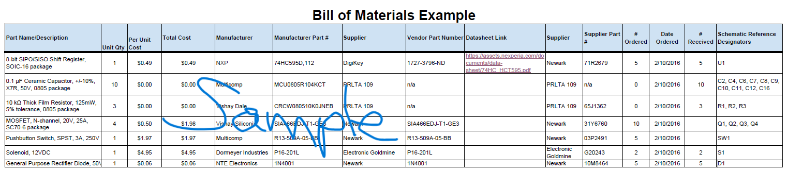

## Overview
written context

## Bill of Materials Example (as Table)

*Table ##: An example of one approach to adding your BOM table to this section.*

| **Part Name/Description** | **Qty** | **Unit Cost** | **Total Cost** | **Manufacture** | **Manufacturer #** | **Vendor Link** |**Datasheet Link** | **Schematic Reference Designators** |
|:--------------------|:----|:---------------|:-----|:--------|:-----|:-----|:----|:-----|
8-bit SIPO/SISO Shift Register, SOIC-16 package | 1 | $0.49 | $ 0.49 | NXP | 74HC595D,112 | [DigiKey](https://www.digikey.com/en/products/detail/nexperia-usa-inc/74HC595D-112/763550) | [datasheet link](https://assets.nexperia.com/documents/data-sheet/74HC_HCT595.pdf) | U1 |
0.1 µF Ceramic Capacitor, +/-10%, X7R, 50V, 0805 package |10 | 0.2750 | $2.75 | KEMET | C0805F104K5RACTU | PRLTA 109 |n/a | C2, C4, C6, C7, C8, C9, C10, C11, C12, C16

 **1. Power Regulation & Protection** 
| **Part Name/Description** | **Qty** | **Unit Cost** | **Total Cost** | **Manufacture** | **Manufacturer #** | **Vendor Link** |**Datasheet Link** | **Schematic Reference Designators** |
|:--------------------|:----|:---------------|:-----|:--------|:-----|:-----|:----|:-----| 
2.1mm x 5.5mm PCB DC Barrel Jack | 1 | $1.25 | $1.25 | CUI Devices | PJ-102AH | [DigiKey](https://www.digikey.com/en/products/detail/cui-devices/PJ-102AH/408448) | [Datasheet](https://www.cuidevices.com/product/resource/pj-102ah.pdf) | J1 | | 500mA Fast-Act Subminiature Fuse | 1 | $0.85 | $0.85 | Littelfuse | 0273.500V | [DigiKey](https://www.digikey.com) | [Datasheet]([suspicious link removed]) | F1 | | +5V 1.5A Linear Voltage Regulator | 1 | $1.53 | $1.53 | STMicroelectronics | L7805ABV-DG | [DigiKey](https://www.digikey.com/en/products/detail/stmicroelectronics/L7805ABV-DG/3945936) | [Datasheet](https://www.st.com) | U1 | | 0.33 µF, 50V Ceramic Input Filter Cap | 1 | $0.25 | $0.25 | TDK Corporation | FG28C0G1H334JNT06 | [DigiKey](https://www.digikey.com) | [Datasheet](https://www.digikey.com) | C1 | | 0.1 µF, 50V Ceramic Output Filter Cap | 1 | $0.15 | $0.15 | KEMET | K104K15X7RF53L2 | [DigiKey](https://www.digikey.com) | [Datasheet]([suspicious link removed]) | C2 | | 12V DC 700mA AC/DC Wall Adapter | 1 | $7.58 | $7.58 | Triad Magnetics | WSU120-0700 | [DigiKey](https://www.digikey.com) | [Datasheet]([suspicious link removed]) | External (J1) 

* You could also import your BOM via a screenshot of the spreadsheet created BOM

## Bill of Materials Example (as Image)
{style width: "2000"}
**Figure 2:** Example Bill of Materials as a screenshot.

As you can see, the text can be difficult to read without opening the image.
