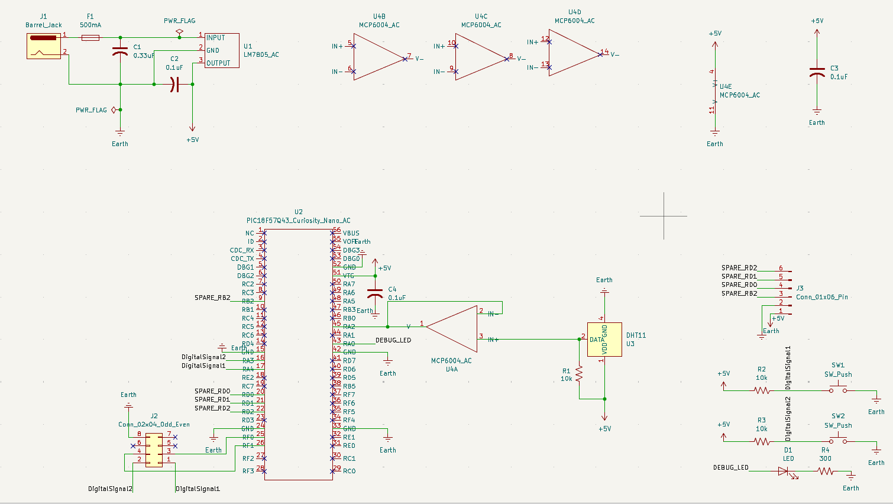

## Overview

This schematic is design to support .... (highlight functionally, power, and controller).
This schematic is designed to support the temperature and humidity sensing transmission subsystem. The circuit measures ambient environmental conditions using a DHT11 digital sensor and transmits environmental data to the main board over UART via a 8-pin ribbon header. 

Power is supplied by an external 12v DC wall adapter through a barrel jack and regulated down to 5 volts using an L7805ABV-DG linear regulator. At the center the PIC18F57Q43 Curiosity Nano microcontroller manages digital I/O, the DHT11 temperature sensor, user push buttons, debug states LED, and a test header for probing/ testing. 

{style width:"350" height:"300;"}
**Figure 01:** Showing Temperature Sensor Schematic.

