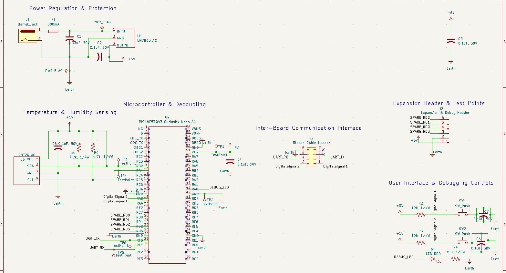

## Overview

This subsystem schematic integrates power regulation, digital processing, environmental sensing, inter-board serial communication, user interface controls via push buttons, and expansion test points into a single PCB design. The system will operate on a +12 volt DC input from a wall plug which is fused and regulated down to +5 volt DC to power the PIC18F57Q43 Curiosity Nano microcontroller, the DHT20 temperature and humidity sensor, and all other peripherals.

{style width:"350" height:"300;"}
**Figure 01:** Showing Temperature Sensor Schematic.

