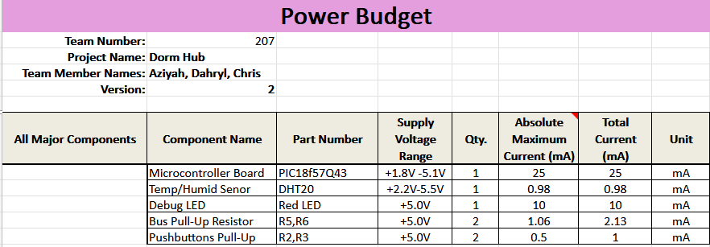
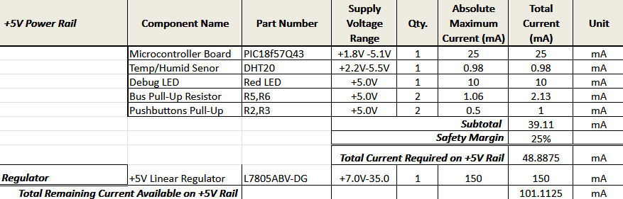
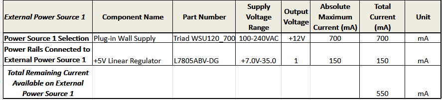

## Overview
A Power Budget was performed to systematically analyze the electrical power requirements of the Temperature & Humidity Sensing Subsystem to ensure the power supply network safely, reliably, and continuously delivers adequate current to all active components under worst-case operating conditions. Conducting this analysis verifies that the external AC/DC wall adapter (12V DC @ 700 mA) provides sufficient current capacity for both the linear regulator and downstream logic, confirms that the +12V DC input provides sufficient headroom above the L7805ABV-DG regulator's 2.0V threshold, and incorporates the mandatory EGR 304 25% current safety margin to prevent over-current shutdowns or power supply failures during peak transits.

## Conclusions

From the prepared Power Budget, several key engineering conclusions can be drawn regarding the stability and reliability of the subsystem design:

* 1. **Sufficient Power Supply Capacity:** The total worst-case operating current required on the +5V regulated rail is 113.1 mA. The L7805ABV-DG regulator easily supplies this demand with 1358.6 mA of remaining current headroom, ensuring stable operations without voltage droop.

* 2. **External Power Supply Margin:** The external 12V 700mA wall adapter provides a total current draw of only 119.1 mA under a full load. This leaves 580.9 mA of unused capacity, allowing significant power margin to feed inter-board power lines or auxiliary devices if needed.

* 3. Dropout Voltage Compliance: The +12V DC input rail provides a 7.0V margin above the +5.0V output, far exceeding the L7805's 2.0V dropout threshold. This guarantees proper regulation even if input wall adapter voltage sags slightly under AC line fluctuations.

## Resouces

The power budget as a PDF download is available [*here*](PowerBudget.pdf), and a Microsoft Excel Sheet [*here*](PowerBudget_AC.xlsx).
