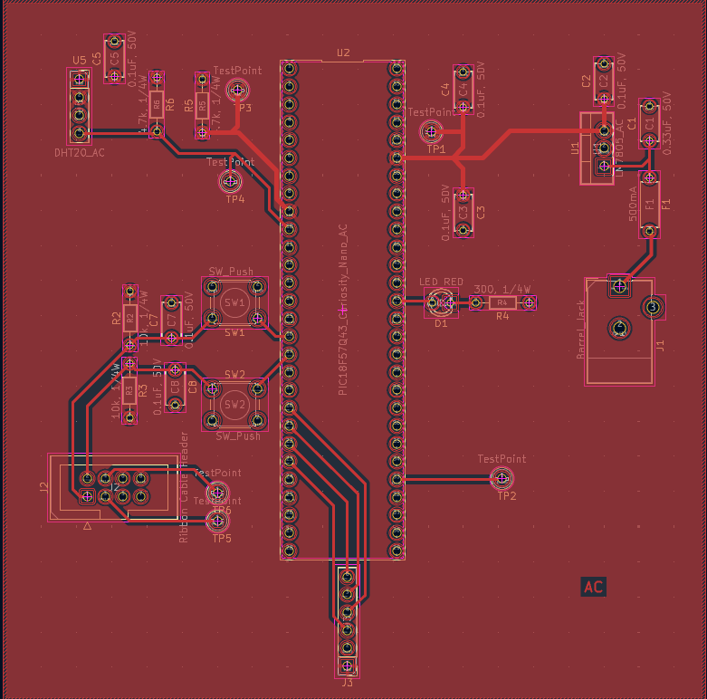
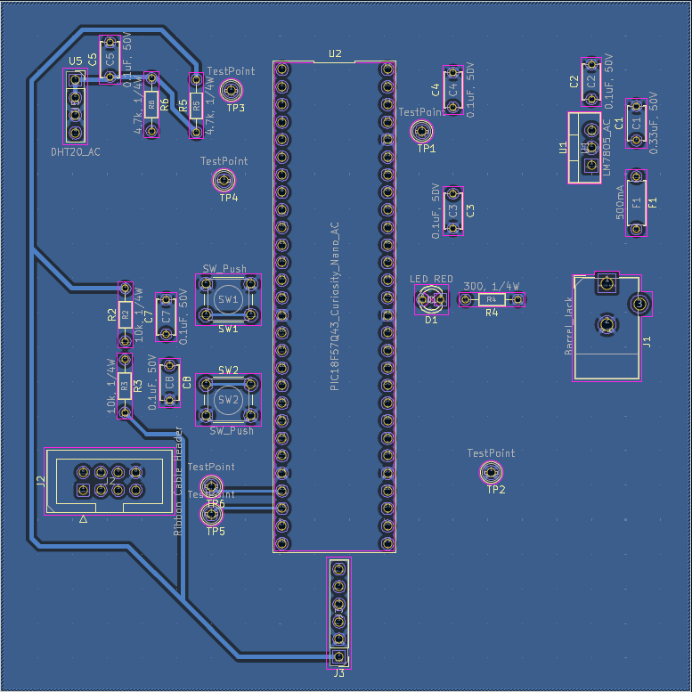

# PCB Design 

## Overview 
This page documents the physical PCB layout for the Temperature & Humidity Sensing Subsystem.

## PCB Layout Visualizations

### Front Copper Layer (F.Cu)

### Back Copper Layer (B.Cu)

## Downloads &a Manufacturing Deliverables

**[Download PCB Layout PDF](pcblay.pdf)**
**[Download Complete ECAD Project ZIP](AC_Subsystem.zip)**
**[Download Gerber & Drill Files (ZIP)](AC207.zip)**
